<div align="center">

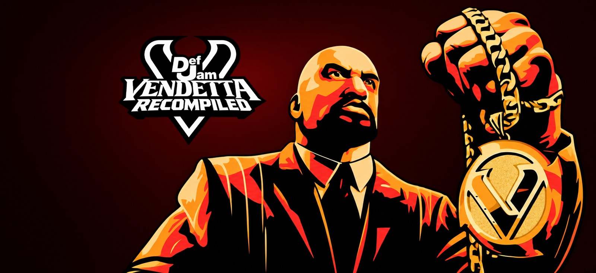

**Def Jam Vendetta, the PlayStation 2 fighter, as a native Windows program, built on your PC from your own disc.**

[](https://github.com/jcsix694/def-jam-vendetta-recomp/releases/latest)

[](https://github.com/jcsix694/def-jam-vendetta-recomp/releases/latest/download/Def-Jam-Vendetta-Recompiled-Windows.zip)

Made by [@jcsix on X](https://x.com/jcsix) · [jcsix694 on GitHub](https://github.com/jcsix694)

</div>

The original PlayStation 2 code is translated to C++ with [PS2Recomp](https://github.com/ran-j/PS2Recomp) and compiled on your
PC, so your CPU runs the game directly. No emulator. The PS2's graphics chip is redrawn on your graphics card with
Vulkan through [paraLLEl-GS](https://github.com/Arntzen-Software/parallel-gs), and the picture is shown with Vulkan
too. **No game files come with it:** you need your own copy of Def Jam
Vendetta (PlayStation 2, USA, **SLUS-20639**) as an `.iso` or `.chd`, and everything made from it stays on your PC.


**Contents**
- [Features](#features)
- [Screenshots](#screenshots)
- [Install](#install)
- [Def Jam Vendetta Recompiled Settings](#def-jam-vendetta-recompiled-settings)
- [Mods](#mods)
  - [The mod kit](#the-mod-kit)
  - [Wrestlers](#wrestlers)
  - [Arenas](#arenas)
  - [Blender plugin](#blender-plugin)
- [Controls](#controls)
- [Good to know](#good-to-know)
- [Thanks to](#thanks-to)
- [Licence](#licence)

## Features

**Picture**
- Up to 16× resolution, scaled to your screen with AMD FSR
- Widescreen matches at 16:9 with more of the arena (menus and movies stay 4:3)
- Sharp 2D: the HUD, text and menus as sharp as the 3D
- High Poly in every match (the PS2 used lower detail models with 3 or 4 fighters)
- Vulkan on your graphics card, in a window or borderless

**Playing**
- Up to 4 players on controllers, plus the keyboard as any player
- Vibration on Xbox-style controllers
- Camera styles: the game's own, WWF No Mercy or Wrestle Kingdom 2
- Match speed: the game's own pace, WWF No Mercy's slower pace or any speed you pick
- Unlock everything, without touching your save

**Easy to use**
- A settings program that sets everything up from your disc and updates itself
- Your saves stay as memory card files on your PC

**Mods**
- New wrestlers and arenas, each with its own place on Choose Fighter and Choose Stage, or in place of the game's own
- Wrestlers with their own models, skins, attires, movesets, animations and voice lines
- Your own animations: moves, intros, victories and taunts, posed frame by frame, with their own sounds and cameras
- Arenas with their own models, textures, lights, crowd sounds and fly-in camera
- Projects: each one has its own mods and its own saves, so the original game and your saves are never touched
- The mod kit comes with the game, with a Blender plugin for models
- Share a project and its mods as one zip

## Screenshots

<table>
<tr>
<td width="33%"></td>
<td width="33%"></td>
<td width="33%"></td>
</tr>
<tr>
<td></td>
<td></td>
<td></td>
</tr>
<tr>
<td></td>
<td></td>
<td></td>
</tr>
<tr>
<td>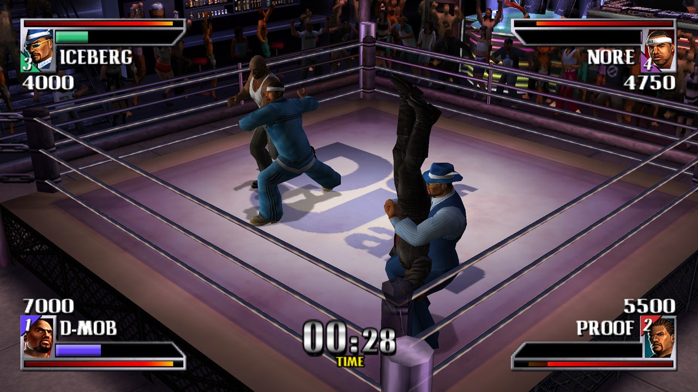</td>
<td>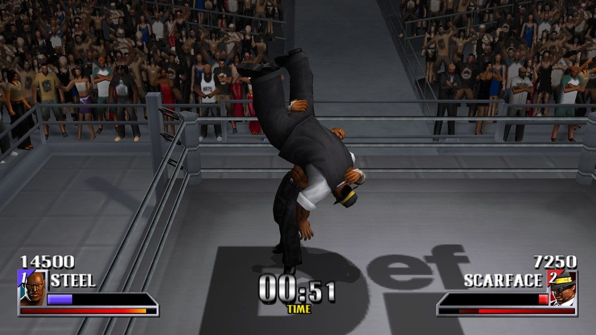</td>
<td>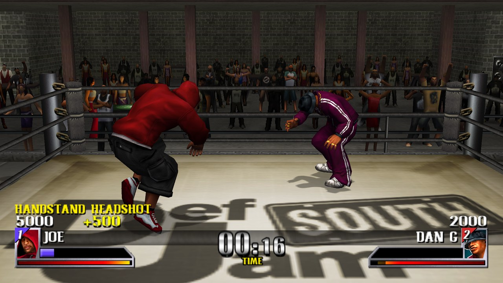</td>
</tr>
</table>

<sub>All taken on PC at the default settings: 16×, Sharp 2D, widescreen (the last row also shows the other camera styles).</sub>

## Install

**You need:** Windows 10 or 11 (64-bit) · a graphics card with Vulkan 1.3 (any recent NVIDIA, AMD or Intel Arc card) ·
about 8 GB of free space · the internet once · your own Def Jam Vendetta disc (USA, SLUS-20639) as an `.iso` or `.chd`.

<table>
<tr>
<td width="50%" valign="top">

1. Download [**Def-Jam-Vendetta-Recompiled-Windows.zip**](https://github.com/jcsix694/def-jam-vendetta-recomp/releases/latest/download/Def-Jam-Vendetta-Recompiled-Windows.zip)
   (the latest version, also on the [releases page](https://github.com/jcsix694/def-jam-vendetta-recomp/releases/latest)).
2. Unzip it somewhere short, like your Desktop or `C:\Games`. The build tools can't handle very long folder paths.
3. Open **Def Jam Vendetta Recompiled Settings.exe**.
4. Pick your disc file, or drop it onto the window. It's checked to be the right disc.
5. Press **Next: build the game**. Microsoft's free C++ build tools are installed first if your PC doesn't have them
   (allow Windows' prompt once). The build takes **20 to 30 minutes, once**, and you can keep using your PC.
6. Choose your settings and press **PLAY**. The install folder gets a **Def Jam Vendetta Recompiled** shortcut that
   starts the game straight away. Two shortcuts go on your desktop too, unless you switched that off: the game, and
   **Def Jam Vendetta Recompiled Settings** for the settings.

</td>
<td width="50%" valign="top">


</td>
</tr>
</table>

> [!TIP]
> Windows may say *"Windows protected your PC"* because the program isn't code-signed yet. Click **More info**, then
> **Run anyway**.

**Updating:** Def Jam Vendetta Recompiled Settings checks for a new version when it opens and offers it on its Play page. It
downloads the new version, swaps in only what changed and rebuilds the game in a few minutes. Your settings and saves are
kept. Starting the game itself checks too: when a new version is out, a popup asks **Update** or **Play**, once per new
version. Turn both checks off under About › Check for updates automatically.

## Def Jam Vendetta Recompiled Settings

<table>
<tr>
<td width="50%"></td>
<td width="50%"></td>
</tr>
<tr>
<td></td>
<td>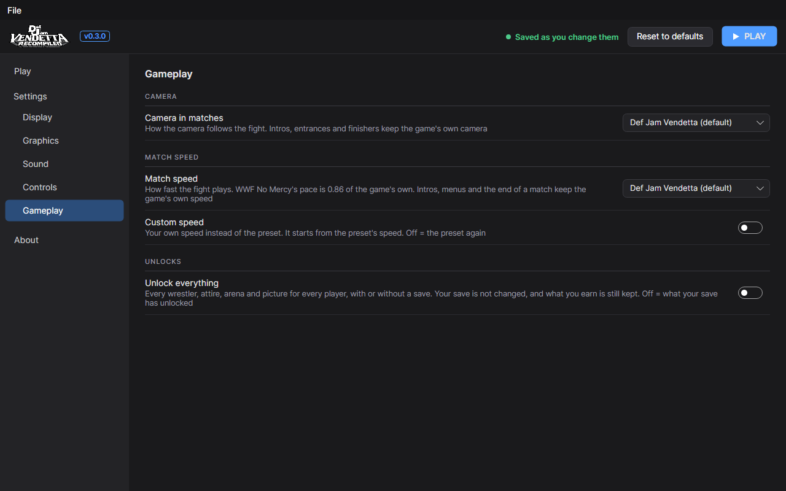</td>
</tr>
</table>

- **Play:** what to play, the original game or one of your projects; new projects, copy, rename, delete, export one to
  share and import one.
- **Mods:** a project's mods in their load order, its mods folder, and the mod kit.
- **Display:** window or borderless, which screen, VSync, and
  widescreen, 4:3 or stretched.
- **Graphics:** graphics card or CPU, scale 1× to 16×, Sharp 2D, and FSR, smooth or blocky scaling with sharpening.
- **Sound:** volume and the arena reverb.
- **Controls:** up to 4 players, each player's controller and vibration, which player the keyboard plays as, and what
  every button does.
- **Gameplay:** the camera style in matches, the match speed (Def Jam Vendetta, WWF No Mercy or your own), and Unlock
  everything.
- **About:** the version, your game folder and save data in one click, and what it's made with.

## Mods

Mods are played in **projects**. A project is a set of mods with its own saves: the original game never loads mods,
and its saves stay as they are.

<table>
<tr>
<td width="50%">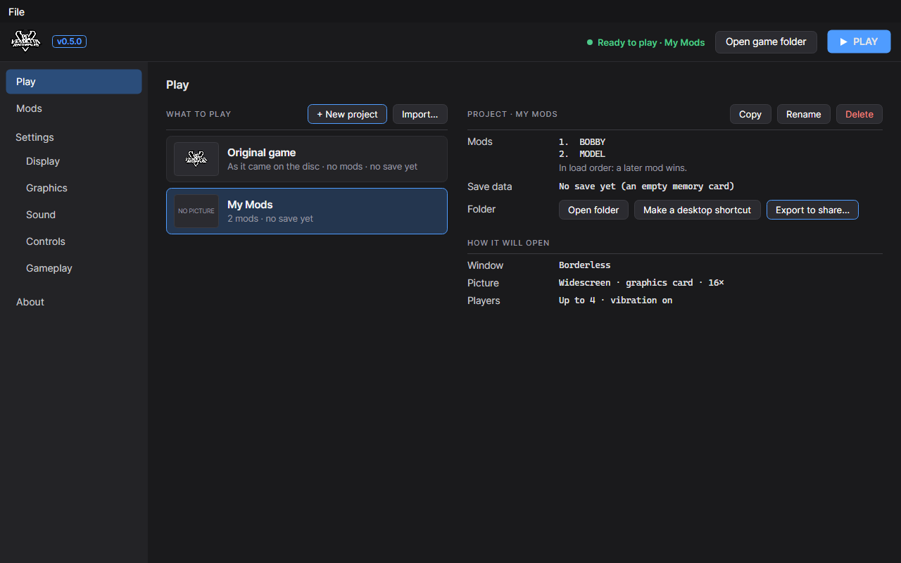<br><sub>The Play page: the original game or one of your projects, each with its own saves.</sub></td>
<td width="50%">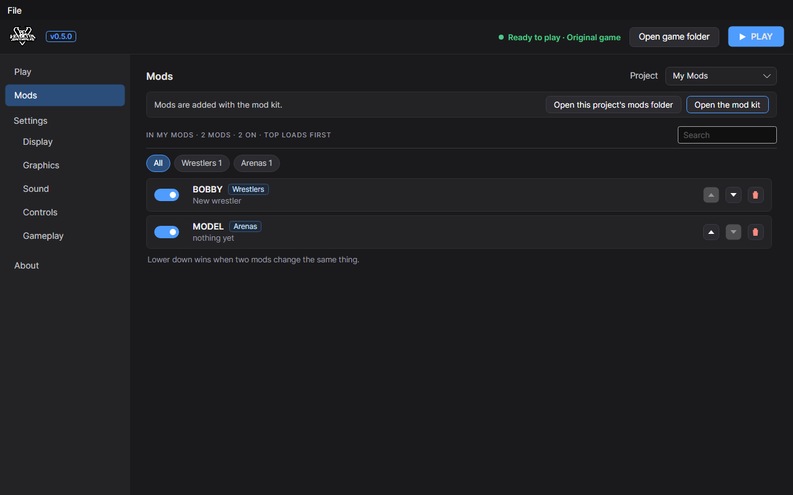<br><sub>The Mods page: a project's mods in load order, each switched on or off.</sub></td>
</tr>
</table>

1. On the **Play** page, press **+ New project** and give it a name.
2. On the **Mods** page, press **Open the mod kit**. It's in the `Mod kit` folder beside Def Jam Vendetta Recompiled
   Settings.
3. In the mod kit, make a wrestler or an arena (or import one someone shared), then press **Add to project…**: it
   either replaces one of the game's own or gets a new place of its own.
4. Back on the **Play** page, pick the project and press **PLAY**.

When two mods change the same thing, the one lower down the Mods page wins. If a project's mods have a problem, the
game tells you before it starts, and the Mods page says what's wrong. To share a project with its mods, use
**Export to share…** on the Play page; the other player brings it in with **Import…**.

### The mod kit

The mod kit makes the mods. Its first start asks for the name you make mods under, and it links itself to the game it
came with.

<table>
<tr>
<td width="50%">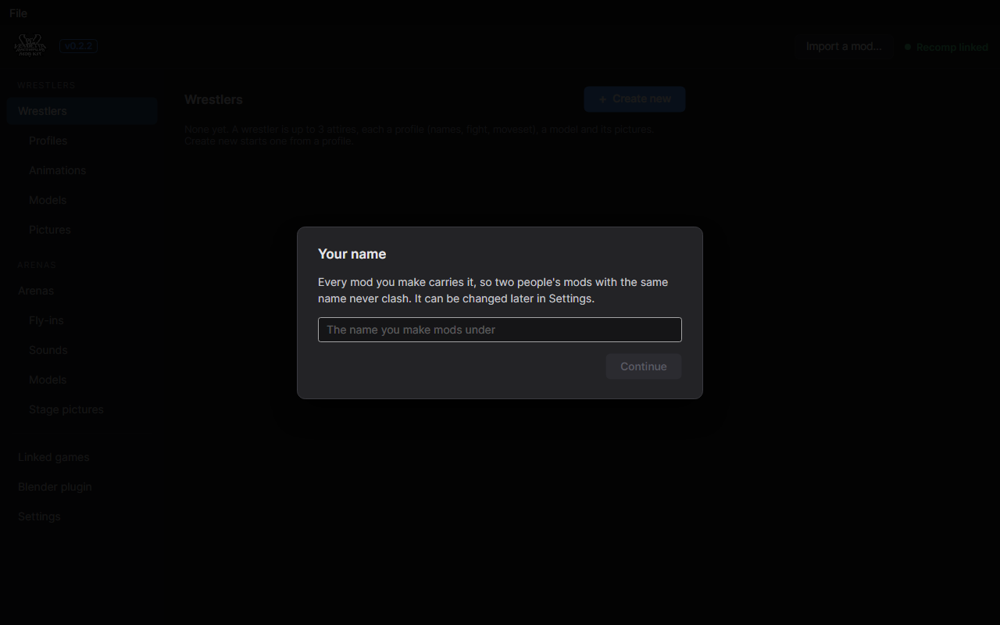<br><sub>Your name goes into every mod you make, so two people's mods never clash.</sub></td>
<td width="50%">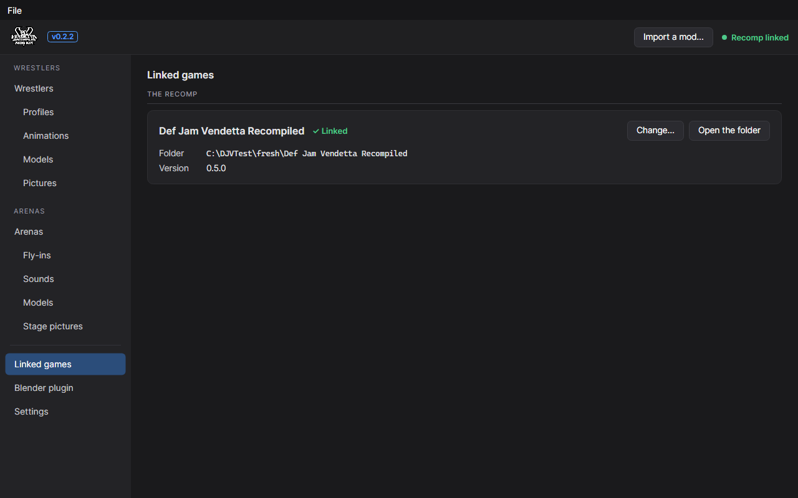<br><sub>Linked games: the game the kit reads from and adds mods to.</sub></td>
</tr>
</table>

### Wrestlers

A wrestler is up to 3 attires, each with a model, a profile and its select screen pictures. It gets a new slot on
Choose Fighter, or takes a game wrestler's place. Everything about it can be your own: its names and size, its stats,
its voice and its intro and win lines, its moveset and combos, its animations, its model and its pictures. Or start
from any of the game's wrestlers and change only what you want.

#### Making a wrestler

<table>
<tr>
<td width="50%">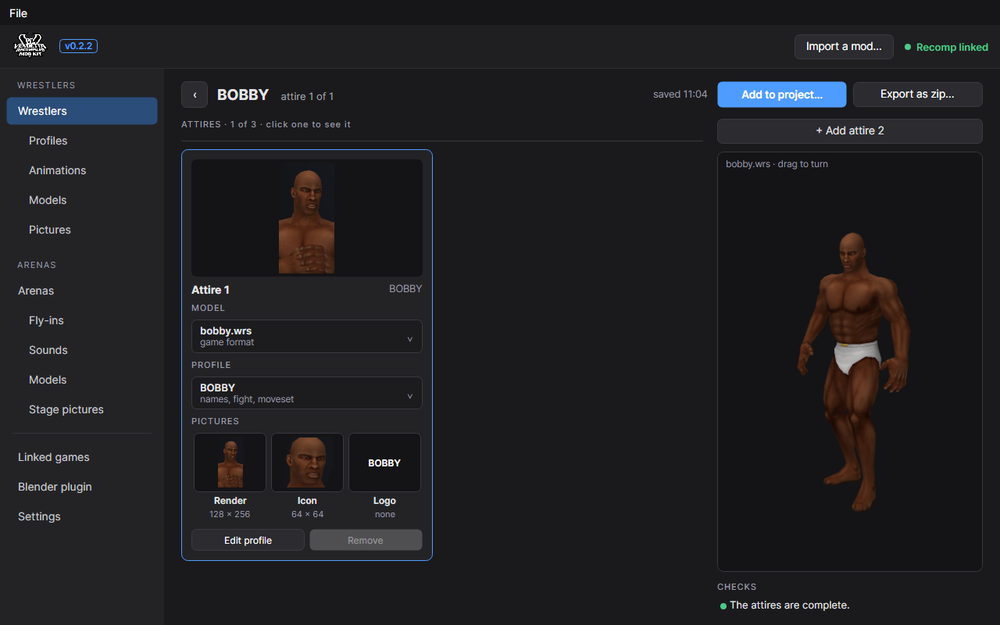<br><sub>The wrestler and its attires, with its model turning in the preview.</sub></td>
<td width="50%">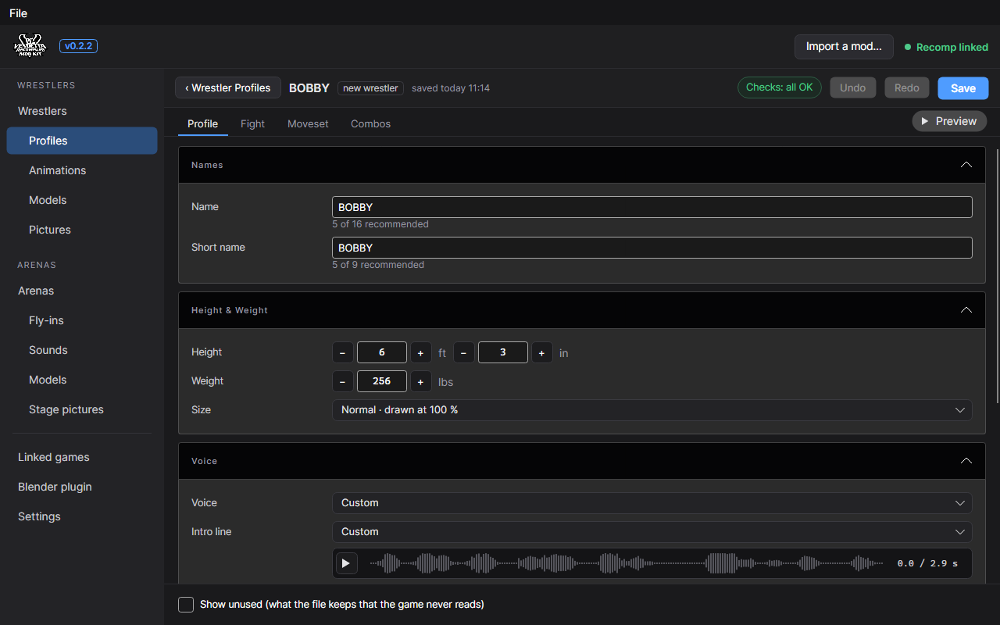<br><sub>The profile: names, height and weight, size, voice, and the intro and win lines.</sub></td>
</tr>
</table>

#### Moves and animations

Every slot in the moveset holds one of the game's moves or one of your own, and the preview plays it on the wrestler's
own model. Your own animations are made in the kit: **Create new** starts one from any of the game's moves, of every
kind the game has (grapples, strikes, running attacks, corner and rope moves, aerials, Blazin' moves, taunts, intros and
victories), and everything about it can then be changed:

- **Pose:** click a body part on the wrestler and drag it. Each change is a key, and the frames between are the game's
  or filled in for you. Copy, paste and mirror poses, save your own, or start from ready-made poses and any frame of a
  game animation.
- **Timing:** add and delete frames, set its speed, and place the moments the game reads: when it hits, when the damage
  lands, and the windows for the ropes, ring shakes and screen shakes.
- **Sounds:** the game's sounds at any frame, or copied from one of the game's animations.
- **Camera:** intros and victories get their own camera, key by key, for each corner of the ring.
- **Face and hands:** the faces, eyes, lips and hand shapes, frame by frame.
- **Before and after:** seen joined to what the game plays before and after it, then tried in a real match.

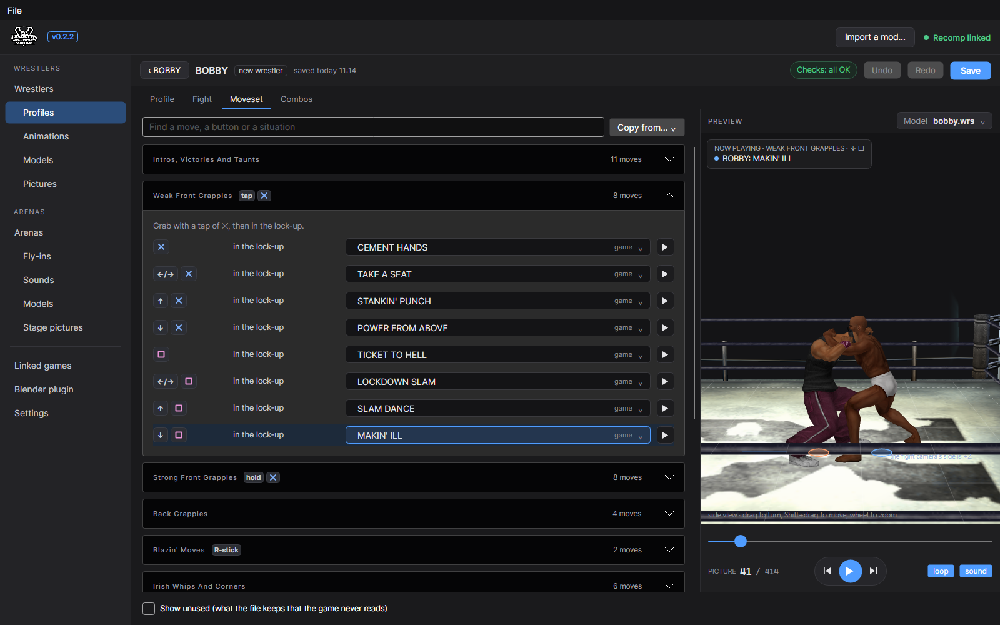<br><sub>The moveset: every slot the game has, grouped by situation with its buttons, each move played in the preview on the wrestler's own model. The Fight and Combos tabs hold the stats and the combos.</sub>

<table>
<tr>
<td width="50%">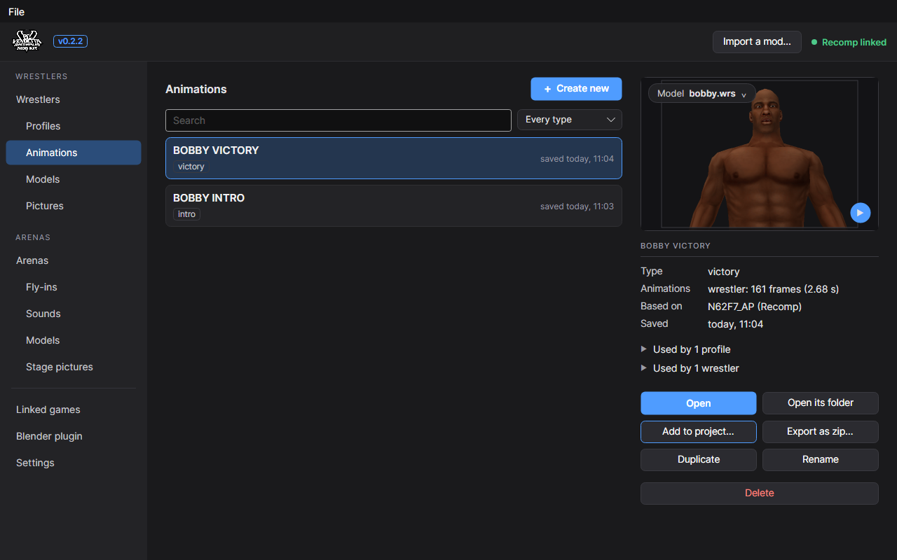<br><sub>Your own intros, victories and moves.</sub></td>
<td width="50%">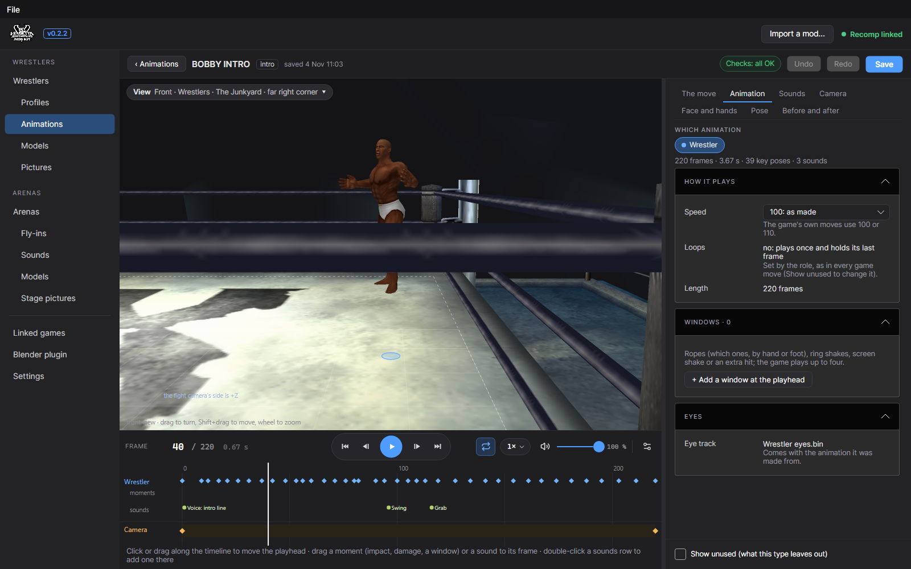<br><sub>The editor: key poses on a timeline, sounds at their frames, the camera, the face and hands.</sub></td>
</tr>
</table>

#### Models and pictures

<table>
<tr>
<td width="50%">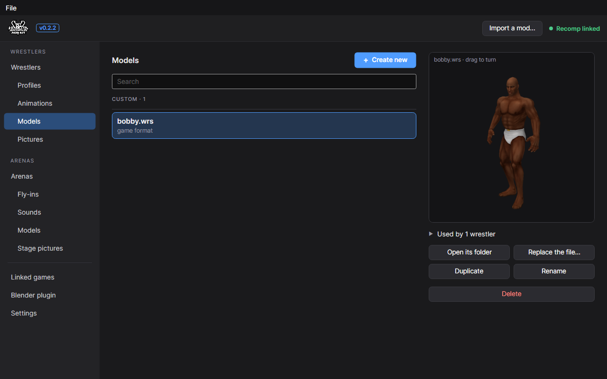<br><sub>Models in the game's format, made in Blender with the plugin.</sub></td>
<td width="50%">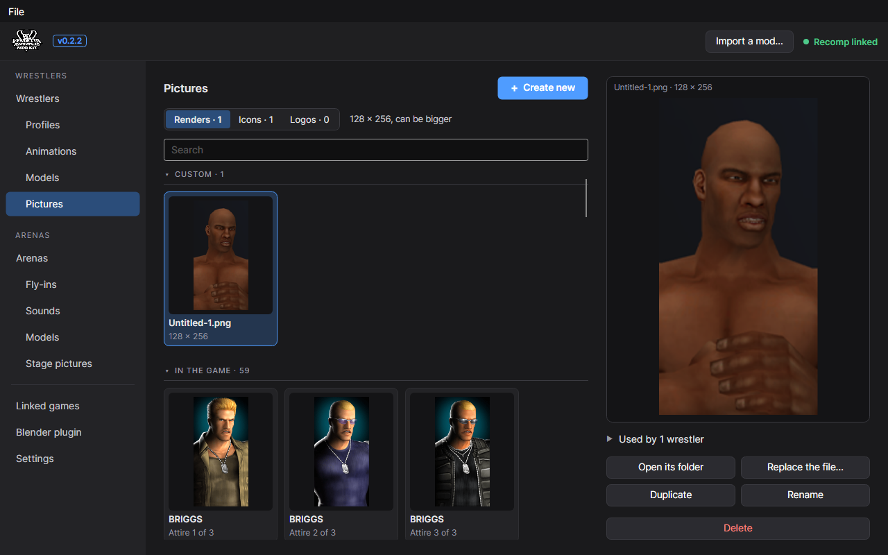<br><sub>Renders, icons and name logos, any size. The game's own can be saved as PNG to start from.</sub></td>
</tr>
</table>

#### Adding to a project

<table>
<tr>
<td width="50%">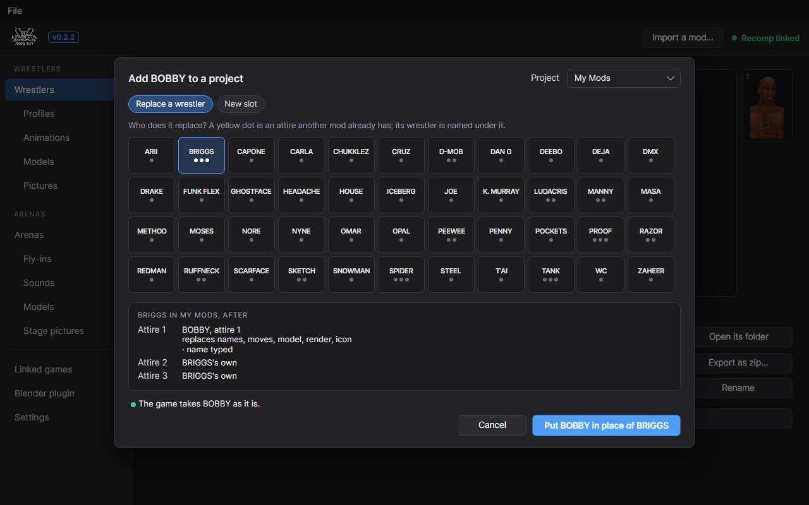<br><sub>Replacing a wrestler: its attires take that wrestler's one by one, and the rest stay the game's own.</sub></td>
<td width="50%">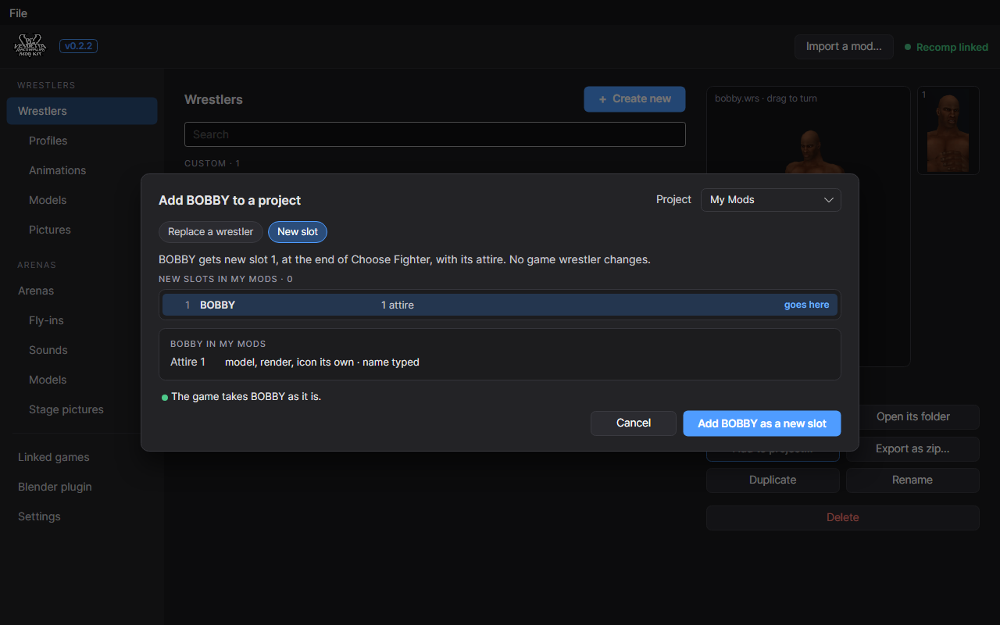<br><sub>A new slot at the end of Choose Fighter: no game wrestler changes.</sub></td>
</tr>
</table>

### Arenas

An arena is its model with its lights, fly-in, sounds and Choose Stage pictures. It gets a new place on Choose Stage,
or takes a game arena's place. Start from any of the game's 12 arenas, or from your own model made in Blender, and
change what you want:

- **Lights:** every light the game uses, for the fight, the intros and close-ups and each part of the crowd: its kind,
  where it sits, how far it reaches, and its colour over time, picked on a colour wheel.
- **Fly-in:** the camera's path into the arena before a match, key by key on a timeline, with its cuts.
- **Sounds:** the crowd, the arena's own sounds and the announcer's welcome, picked from the game's recordings.
- **Choose Stage:** its big picture, thumbnail and name strip, any size.

#### The arena

<table>
<tr>
<td width="50%">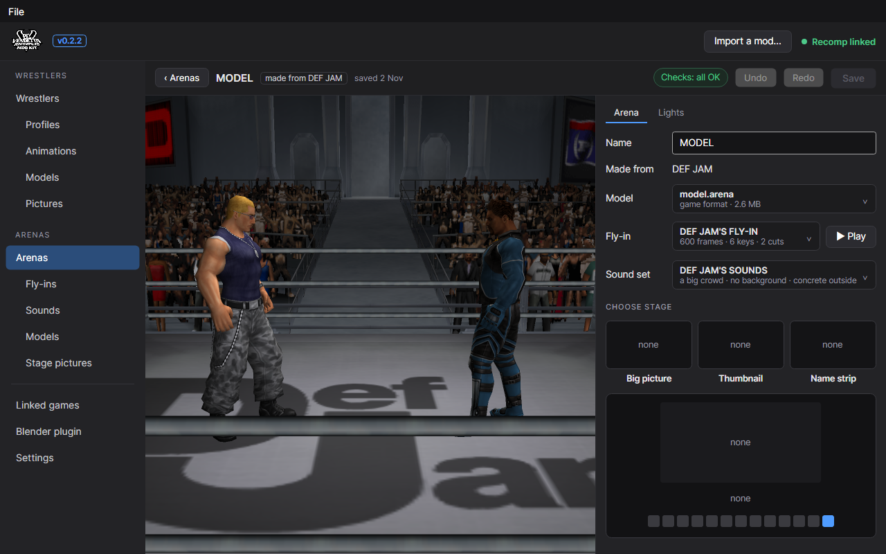<br><sub>The arena and what it uses, seen with two wrestlers in it.</sub></td>
<td width="50%">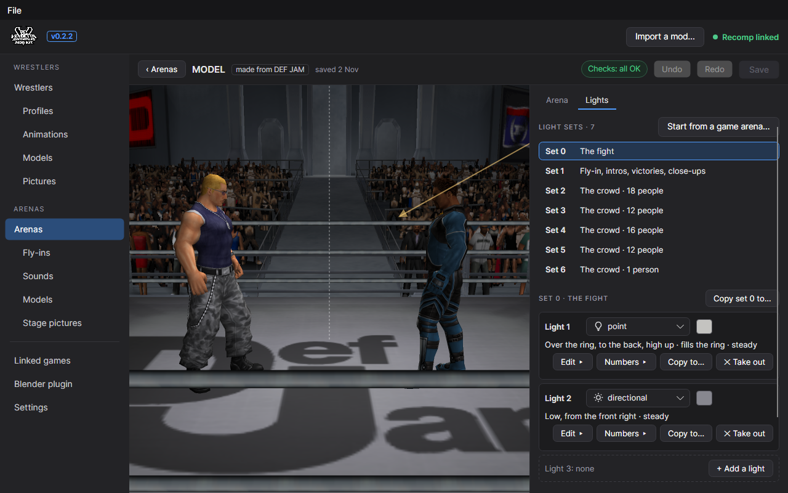<br><sub>Lights: each set the game uses, for the fight, the intros and close-ups, and the crowd.</sub></td>
</tr>
</table>

#### Fly-ins and sounds

<table>
<tr>
<td width="50%">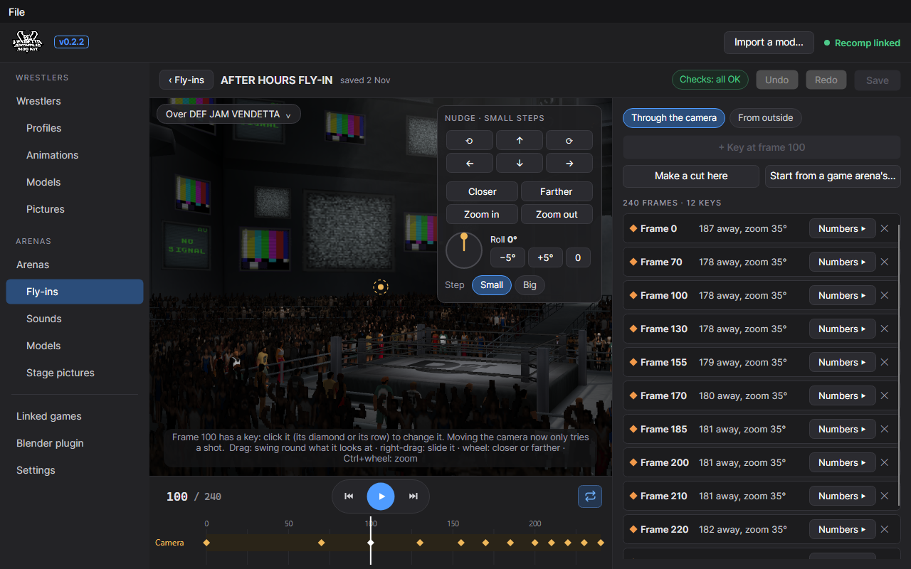<br><sub>The fly-in: the camera's path into the arena, key by key on a timeline.</sub></td>
<td width="50%">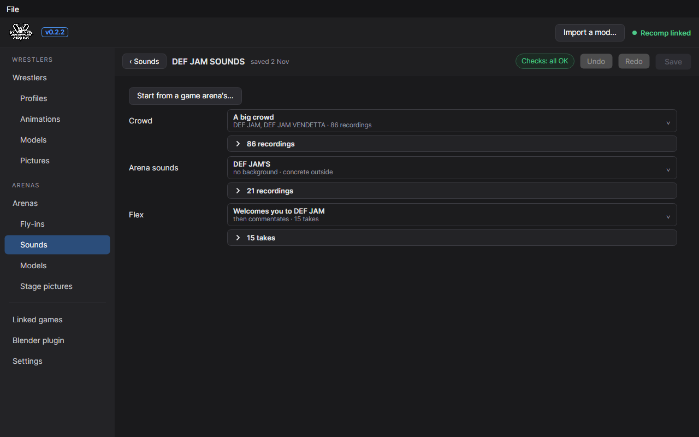<br><sub>Sounds: the crowd, the arena's own sounds and the announcer's welcome.</sub></td>
</tr>
</table>

#### Models and pictures

<table>
<tr>
<td width="50%">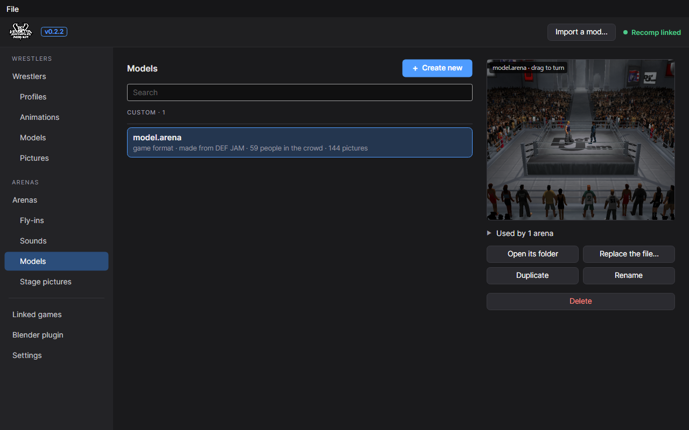<br><sub>Arena models in the game's format, with their crowd and pictures.</sub></td>
<td width="50%">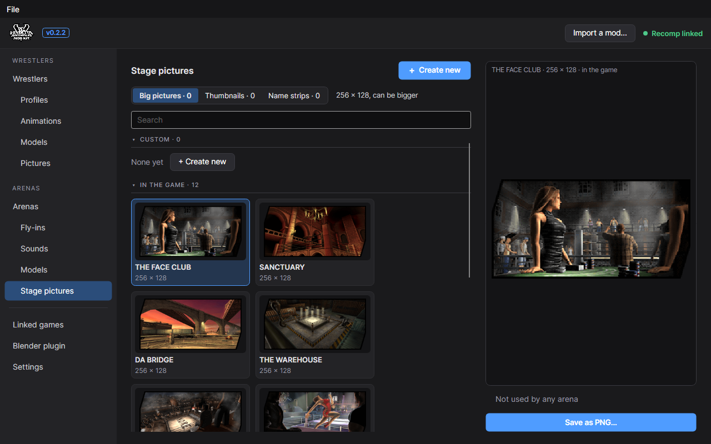<br><sub>Choose Stage's big picture, thumbnail and name strip. The game's own can be saved as PNG.</sub></td>
</tr>
</table>

#### Adding to a project

<table>
<tr>
<td width="50%">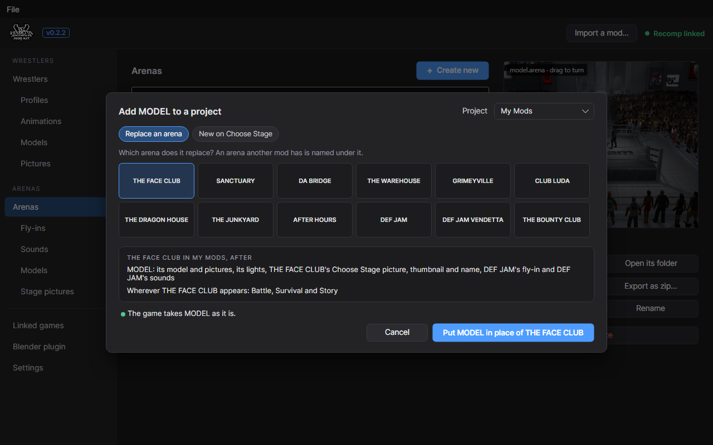<br><sub>Replacing an arena: it takes that arena's place in Battle, Survival and Story.</sub></td>
<td width="50%">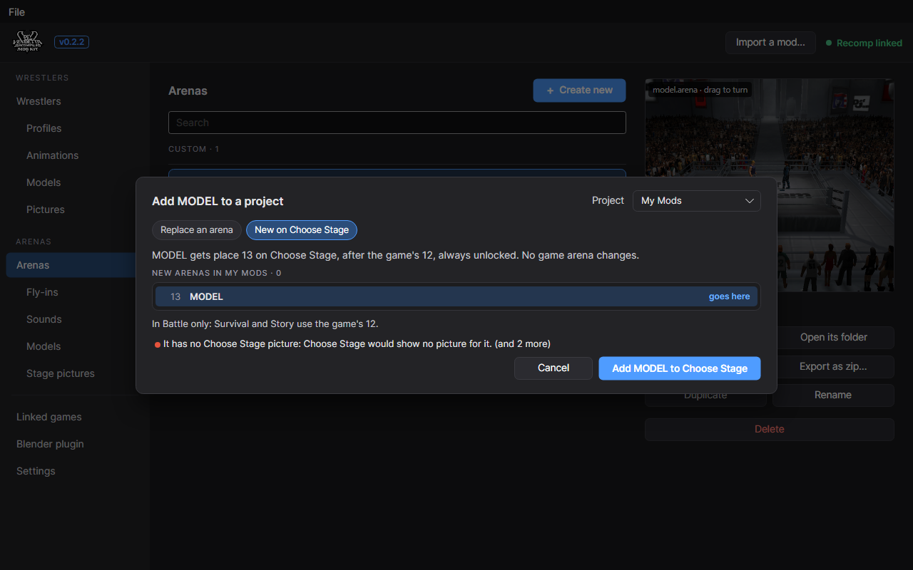<br><sub>New on Choose Stage, after the game's 12, in Battle. The kit's checks say what's still missing.</sub></td>
</tr>
</table>

### Blender plugin

Wrestlers' and arenas' models are made in Blender, version 5.2 or newer. The kit's Blender plugin page downloads the
plugin, which brings the game's models into Blender and exports yours for the kit.

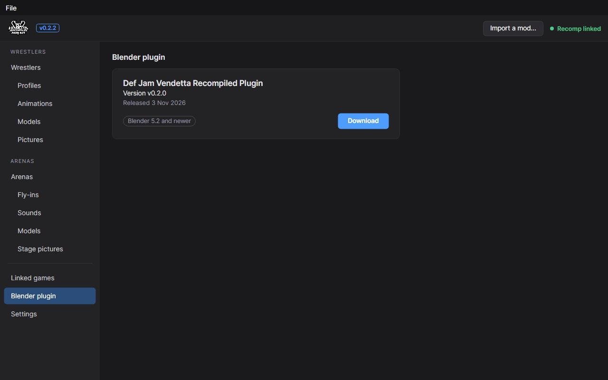

## Controls

| PS2 | In a match | Controller (Xbox layout) | Keyboard |
| --- | --- | --- | --- |
| D-pad / left stick | move | D-pad / left stick | Arrow keys / W A S D |
| ✕ Cross | grapple | A | X / Space |
| ○ Circle | run, climb | B | C / Esc |
| □ Square | strike | X | Z / Numpad 0 |
| △ Triangle | | Y | V / Numpad 1 |
| L1 / R1 | dodge / block | LB / RB | Q / E |
| L2 / R2 | | LT / RT | Left Shift / Right Shift |
| Right stick | taunt, Blazin' | right stick | I J K L |
| Start / Select | pause | Menu / View | Enter / Tab |

Xbox-style controllers work out of the box, with vibration, and are given to players in the order Windows lists them.
PlayStation controllers work through Steam or DS4Windows. The keyboard plays as nobody until you pick a player on the
Controls page.

## Good to know

- **Your saves** are memory card files in `files\game\mc0` (About › Open save data). Copy that folder to back them up.
  Each project keeps its own in its folder under `files\projects`.
- **Running slowly?** 16× (the default) needs a fairly strong graphics card: try 8× on the Graphics page.
- **Preparing graphics:** the setup and each update prepare the graphics card's shaders (about 2 minutes), so the game
  starts quickly. After a graphics driver update the game prepares them again once, with a "Preparing graphics" popup.
- **Vibration** can also be turned off in the game's own pause menu.
- **Camera styles** (on the Gameplay page):
  - **Def Jam Vendetta:** the game's own camera, the default.
  - **WWF No Mercy style:** looking down on the ring from the side, without swinging round the fighters.
  - **Wrestle Kingdom 2 style:** the ring seen from a corner, like a diamond. The D-pad and left stick are turned to
    match it, so up still moves up the screen.
  - Intros, entrances and finishers keep the game's own camera in every style.
- **Match speed** (on the Gameplay page): Def Jam Vendetta's own pace (the default) or WWF No Mercy's slower pace.
  Turn on Custom speed to pick any speed from 0.750 to 1.250 with the slider, or type it in. It only changes the fight
  itself, from the moment it starts until the match is decided. Intros, menus and everything after stay at normal
  speed, and the match clock follows the chosen speed.
- **Unlock everything** (on the Gameplay page, off by default): every wrestler, attire, arena and gallery picture for
  every player, with or without a save. Your save is never changed, and anything you unlock while playing is still
  saved, so turning it off puts you back where your save is.
- **Your settings** are in `files\settings.toml`. Def Jam Vendetta Recompiled Settings writes it, and you can edit it by hand.

<details>
<summary><b>For developers: building from source</b></summary>

<br>

The build translates the game's code from your own disc, so you need one here too. This repository has no game files
or game code. Everything made from your disc (`disc\`, `game\`, `generated\`) stays on your PC and is ignored by git.

Needs Windows, [Visual Studio 2022 Build Tools](https://visualstudio.microsoft.com/downloads/) (the "Desktop
development with C++" workload), Python 3 and git. Def Jam Vendetta Recompiled Settings needs the .NET 10 SDK.

```bat
git clone https://github.com/jcsix694/def-jam-vendetta-recomp
cd def-jam-vendetta-recomp
setup.bat                                        :: the submodules, PS2Recomp + our patch, the recompiler
python tools\prepare_disc.py "D:\path\to\Def Jam Vendetta.chd"    :: or the .iso
recomp.bat                                       :: the game's code → C++ (~2 min)
build-fast.bat                                   :: build it (first time ~12 min)
run.bat                                          :: run it
build-settings.bat                               :: Def Jam Vendetta Recompiled Settings
make-release.bat                                 :: a player's zip in dist\ (nothing is published)
```

Clone without `--recurse-submodules`: `setup.bat` fetches only the parts of paraLLEl-GS's own submodules it needs (a
full recursive clone runs into Windows' path-length limit). `prepare_disc.py` checks it's the right disc, then writes
`disc\SLUS-20639.iso` (the game reads its disc by sector) and `game\` (the disc's files). A player's zip has Vendetta
Settings, a portable Python and the source with our patches applied. Its first launch runs `tools\setup_game.py`.

The game reads `settings.toml` from its folder. A switch set before `run.bat` wins over the file:

| Switch | |
|---|---|
| `VENDETTA_SSAA=1/2/4/8/16` | samples per pixel on the graphics card (`scale`) |
| `VENDETTA_GS=cpu` | draw on the CPU instead (the PS2's own resolution) |
| `VENDETTA_FILTER=fsr/bilinear/nearest` | scaling to the window (`filter`), and `VENDETTA_SHARPEN=0..2` for FSR's sharpening |
| `VENDETTA_GPU=<number or name>` | which graphics card, e.g. `nvidia` |
| `VENDETTA_WIDESCREEN=16:9/21:9/16:10/1` | the match's view widened (`shape`) |
| `VENDETTA_UPSCALE_SPRITES=1/0` | Sharp 2D (`sharp_2d`) |
| `VENDETTA_KEYBOARD=1..4/0` | the keyboard's player (`keyboard`, 0 = nobody) |
| `VENDETTA_SPU_INTERP=linear` | the sound chip's voices interpolated linearly instead of the PS2's Gaussian |
| `VENDETTA_CAMERA=vendetta/nomercy/wk2` | the camera style (`camera`) |
| `VENDETTA_UNLOCKALL=1/0` | unlock everything (`unlock_all`) |
| `VENDETTA_MATCH_SPEED=0.75..1.25` | the fight's speed (`match_speed` = `vendetta` 1.0 or `nomercy` 0.86, or `custom_speed` with `custom_match_speed`) |
| `VENDETTA_PRESENT=opengl` | the older OpenGL window instead of the Vulkan one |

F1 shows the debug panel. In the repository: `config\` (the recompiler's inputs: the function map from Ghidra, Sony
library routines bound to the runtime's own, missed function starts), `overrides\` (game-specific runtime code),
`patches\` (our changes to PS2Recomp and paraLLEl-GS), `settings-app\` (Def Jam Vendetta Recompiled Settings, Avalonia on .NET 10),
`third_party\parallel-gs` (submodule), `tools\` (disc preparation, the VU1 recompiler, release and setup scripts,
debugging helpers).

</details>

## Thanks to

- **Def Jam Vendetta** by AKI Corporation, published by EA Sports BIG (2003).
- [**PS2Recomp**](https://github.com/ran-j/PS2Recomp) by ran-j, which translates the PS2 code and runs it.
- [**paraLLEl-GS**](https://github.com/Arntzen-Software/parallel-gs) by Arntzen Software, the PS2's graphics chip on
  your graphics card (with [Granite](https://github.com/Themaister/Granite)).
- [raylib](https://github.com/raysan5/raylib), [Dear ImGui](https://github.com/ocornut/imgui), [FFmpeg](https://ffmpeg.org),
  [Avalonia](https://github.com/AvaloniaUI/Avalonia) and the rest in `THIRD-PARTY-NOTICES.txt`.

## Licence

Copyright (C) 2026 jcsix694 (@jcsix on X). Free software under the **GNU General Public License version 3** (`LICENSE`):
use it, change it and share it. A changed version you share must come with its source, under the same licence.

It has to be the GPL: PS2Recomp (ran-j, GPL-3.0) is built into the game program, and our changes to it (`patches\`) are
under its licence. Our changes to paraLLEl-GS (`patches\parallel-gs-local.diff`) are under its LGPL-3.0+. paraLLEl-GS
(© Arntzen Software AS) is LGPL-3.0+ and uses Granite (© Hans-Kristian Arntzen, MIT). Both are included as submodules.
Every other part and its licence: `THIRD-PARTY-NOTICES.txt`.

The mod kit in the download's `Mod kit` folder is a separate program by the same author that comes with the game. Its
code isn't in this repository, and this licence doesn't cover it.

<sub>Not affiliated with or endorsed by Electronic Arts, EA Sports BIG, AKI Corporation or Def Jam Recordings. Def Jam
Vendetta and its name, logo and artwork belong to their owners. The banner and Def Jam Vendetta Recompiled Settings' pictures are artwork
based on its logo, and the licence doesn't cover them. This repository contains no game code or game files. The
screenshots are of the game running on PC. Please don't open issues asking for game files.</sub>
